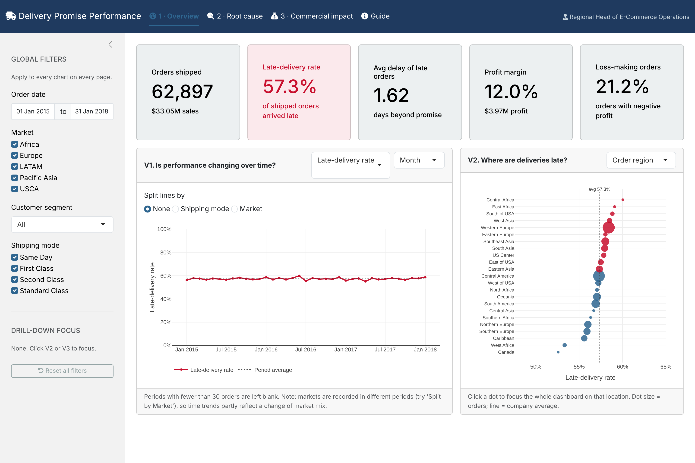

# Delivery Promise Performance Dashboard

An interactive R Shiny dashboard built for the **Regional Head of E-Commerce Operations**, analysing why more than half of an online retailer's orders arrive later than promised (DataCo supply-chain dataset, Jan 2015 – Jan 2018).

**Live dashboard:** `https://<your-username>.github.io/<repo-name>/` *(update after the first deployment)*



## Key findings

- **57.3%** of 62,897 shipped orders arrived after the promised date, a rate that stayed between 55% and 60% every month.
- Location barely matters: the five markets differ by only 1.2 percentage points.
- The cause is the shipping-mode promise. **First Class** is promised in 1 day but always takes 2 (**100% late**); **Second Class** is promised in 2 days but takes 4.0 on average (**80% late**).
- Re-setting promises to match capability would cut the late rate from **57.3% to 34.3%** (scenario panel).

## Features

- Five linked visualisations: monthly trend, regional dot plot, promise-vs-reality diverging bar, region × shipping-mode heatmap, and revenue exposure by category
- Global filters (date, market, segment, shipping mode) applied across three pages
- Click-to-drill cross-filtering from locations and shipping modes
- "What-if" scenario panel for re-setting delivery promises
- Order-level drill-down table with CSV export

## How it is hosted

GitHub Pages only serves static files, so the app is converted with [shinylive](https://posit-dev.github.io/r-shinylive/), which runs R in the visitor's browser via WebAssembly. The workflow in `.github/workflows/deploy.yml` builds and publishes the site on every push to `main`. The first load takes a little while (roughly 20–60 seconds) while R and the packages download in the browser.

## Repository structure

```
app/
  app.R            Shiny app (runs in the browser and in RStudio)
  lines.rds        Pre-processed data used by the app (~2 MB)
prepare_data.R     Rebuilds app/lines.rds from the raw data.csv
screenshots/       Dashboard screenshots
.github/workflows/ GitHub Actions workflow for GitHub Pages
```

## Run locally

Open `app/app.R` in RStudio and click **Run App** (missing packages are installed automatically).

To rebuild the data file from the raw dataset, place `data.csv` in the repository root and run `Rscript prepare_data.R`.

## Data

DataCo Smart Supply Chain dataset (Constante, Silva & Pereira, 2019, Mendeley Data). The raw `data.csv` is not included in this repository because of its size.

---
Built for ETW2001 Foundations of Data Analysis, Monash University. R, Shiny, bslib, plotly, DT and data.table.
